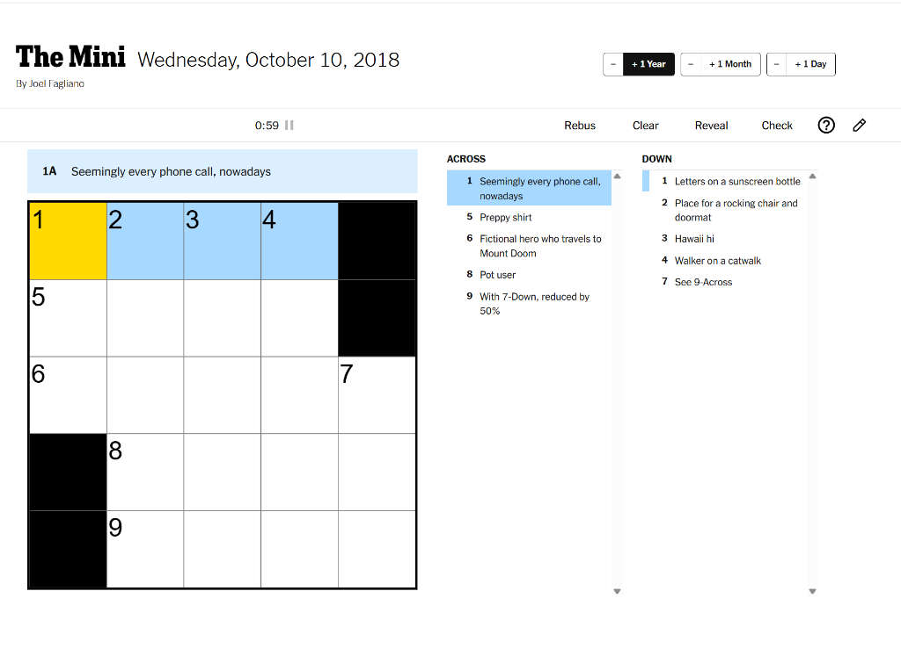

# NYT Mini Crossword Date Navigator

A lightweight browser extension that injects on-screen date controls directly into the NYT Mini Crossword header, allowing seamless navigation across years, months, and days.



## Features

- **On-Screen Navigation**: Adds `+ 1 Year`, `+ 1 Month`, and `+ 1 Day` buttons (with `−` decrement steppers) directly into the puzzle header.
- **Focus on Flow**: Advance years with one click without touching the URL bar.
- **Completion Screen Shortcut**: Adds a direct "Next Year" button in the puzzle completion moment screen.
- **Date Range Aware**: Disables invalid dates (prior to August 21, 2014 or in the future) and correctly handles leap years (e.g. Feb 29).
- **Keyboard Shortcuts**:
  - `Alt + Y`: Next Year (+1Y)
  - `Alt + Shift + Y`: Previous Year (−1Y)
  - `Alt + M`: Next Month (+1M)
  - `Alt + Shift + M`: Previous Month (−1M)
  - `Alt + D`: Next Day (+1D)
  - `Alt + Shift + D`: Previous Day (−1D)

## Installation (Chrome, Edge, Brave)

1. Clone this repository:
   ```bash
   git clone https://github.com/lorempipsum/nytgames-browser-ext.git
   ```
2. Open `chrome://extensions` (or `edge://extensions` / `brave://extensions`).
3. Toggle on **Developer mode** in the top right.
4. Click **Load unpacked**.
5. Select the `nytgames-browser-ext` folder.
6. Open [The Mini](https://www.nytimes.com/crosswords/game/mini) or any archive puzzle to start solving.

## License

This project is licensed under the [MIT License](LICENSE).

